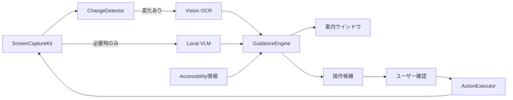
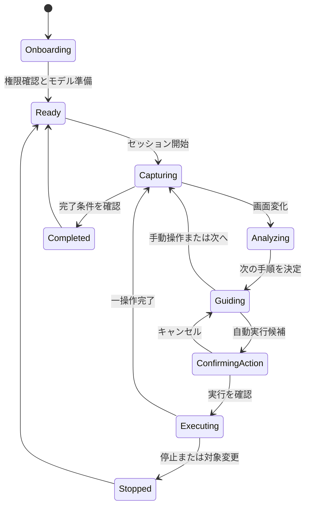

# 操作ナビ (SousaNavi) 技術設計

## 1. 設計方針

M1、8GB環境でPhotoshopとローカル画像モデルを同時に動かすため、
常時処理と重いAI処理を分離する。

- 画面変化、OCR、ウインドウ検出はmacOS標準フレームワークで行う
- 視覚言語モデルは判断が必要なときだけ呼び出す
- すべてのAI出力を構造化し、直接クリック命令として扱わない
- 自動実行の直前に対象を再検証する
- OS依存機能はprotocolで抽象化してテスト可能にする

## 2. 技術スタック

- 言語: Swift
- UI: SwiftUI、必要箇所のみAppKit
- 画面取得: ScreenCaptureKit
- 文字認識: Vision
- 画像処理: Core Image、Accelerate
- ウインドウ情報: Core Graphics
- 自動操作: macOS Accessibility API
- 設定: UserDefaults
- 履歴: Core Data
- ファイル整合性: CryptoKit
- 通信: URLSession
- ローカルAI実行: llama.cppの組み込みライブラリ
- 自動ビルド: GitHub ActionsのmacOS runner

ScreenCaptureKitはmacOS 12.3以降を対象とする。

## 3. ローカルAI

### 初期候補

- モデル: Qwen2.5-VL-3B-InstructのGGUF量子化版
- 量子化: Q4クラス
- ランタイム: llama.cpp `libmtmd`
- 配布: アプリ初回起動後にモデルとmultimodal projectorを取得

選定理由:

- 画像、UI、文字、レイアウトを同時に扱える
- 画面内の位置を構造化して返せる
- 日本語の指示と回答に対応できる
- 3Bクラスの量子化版は8GB環境で検証可能な規模
- llama.cppはMetalを利用でき、外部サーバーを必要としない

最終採用前に、モデルライセンス、再配布条件、GGUF変換元、チェックサムを確認する。

### 低メモリ設定

- 解析画像は対象ウインドウへクロップする
- AI入力用画像は長辺896pxを上限とする
- 画面全体と必要領域の2枚までに制限する
- コンテキスト長は小さく保つ
- 出力は最大512トークン程度とする
- 同時推論数は1
- 推論中の新規要求は最新1件だけ保留する
- セッション終了後にモデルを解放できるようにする

## 4. コンポーネント

### AppCoordinator

- アプリ全体の状態管理
- 権限、モデル、対象アプリ、セッション状態を統合
- 画面間の遷移を制御

### PermissionService

- 画面収録権限の確認
- アクセシビリティ権限の確認
- macOS設定画面への案内
- 権限がない状態で該当機能を開始させない

### CaptureService

- 取得可能な画面とウインドウを列挙
- Photoshopウインドウを候補として表示
- 選択したウインドウのフレームを取得
- 自アプリの案内ウインドウを除外
- 画面全体モードへ切り替え

### ChangeDetector

- フレームを縮小、グレースケール化
- ヒストグラム差分と知覚的差分で変化を判定
- カーソル点滅や小さなアニメーションを無視
- 閾値を超えた場合だけ認識パイプラインへ通知

### OCRService

- Visionで日本語と英語を認識
- 文字列、信頼度、画面座標を返す
- Photoshopのメニュー、パネル、ダイアログ候補を抽出

### AccessibilityService

- Photoshopのアクセシビリティツリーを取得
- ラベル、役割、状態、位置を読み取る
- 自動操作候補の画面座標を検証
- 権限がない場合は読み取りと操作を行わない

### LocalModelService

- モデルの取得、再開、検証、削除
- llama.cppランタイムの初期化と解放
- 画像とプロンプトから構造化JSONを生成
- タイムアウトとキャンセルに対応

### GuidanceEngine

- 色調補正フローを状態機械として管理
- OCR、画面差分、AI判断を統合
- 次の一手と完了条件を決定
- 「戻る」「次へ」「判断できない」を処理
- AI出力が不正な場合は安全な固定案内へフォールバック

### ActionExecutor

- 実行前に対象アプリ、ウインドウ、要素を再検証
- 確認済みの一操作だけをAccessibility APIで実行
- マウス移動、対象変更、「停止」でキャンセル
- クリック後の変化を確認し、成功と決めつけない

### HistoryStore

- 文章履歴をCore Dataへ保存
- 設定が有効な場合のみ画像をApplication Supportへ保存
- 保存期間に基づく削除
- 全削除

## 5. データフロー



## 6. 構造化AI出力

AIには自由文だけを返させず、次のようなデータへ制限する。

```json
{
  "screenState": "photoshop_document_open",
  "confidence": 0.86,
  "observation": "画像がやや暗く、青みが強い",
  "nextStep": {
    "kind": "open_adjustment_layer",
    "targetLabel": "トーンカーブ",
    "instruction": "調整レイヤーからトーンカーブを選択してください",
    "successCondition": "トーンカーブのプロパティが表示される"
  },
  "requiresConfirmation": true
}
```

検証規則:

- 未知の`kind`は拒否する
- `confidence`が閾値未満なら自動実行候補を作らない
- 座標はAI出力だけで決めない
- OCRまたはAccessibility情報との一致を必須にする
- 1回の応答で複数操作を実行しない

## 7. 状態遷移



## 8. UI構成

### メイン案内ウインドウ

- 上部: 対象アプリ、取得範囲、状態
- モード: 「案内」「自動実行」のセグメント
- 中央: 現在の手順と短い補足
- 進行表示: 現在位置と完了済み手順
- 下部: 戻る、次へ、判断できない、停止
- 自動実行候補がある場合だけ「実行」を表示

ボタンにはSF Symbolsを使用し、不慣れなアイコンにはツールチップを付ける。
主要コマンドにはアイコンと短い日本語ラベルを併用する。

### 設定ウインドウ

- 一般
- 画面取得
- AI
- 自動実行
- 履歴

設定項目にはトグル、ポップアップメニュー、ステッパーを使い、
説明文だけの独自操作部品は作らない。

## 9. ディレクトリ案

```text
SousaNavi/
  App/
  Features/
    Onboarding/
    Guidance/
    Settings/
    History/
  Services/
    Capture/
    Recognition/
    Model/
    Automation/
    Persistence/
  Domain/
    Guidance/
    ScreenState/
    Actions/
  Resources/
    Fixtures/
    Localization/
  Tests/
    Unit/
    Integration/
    UI/
```

## 10. テスト方針

### 自動テスト

- 画面差分の閾値判定
- OCR結果からのUI候補抽出
- AI JSONの検証と不正入力拒否
- 案内状態の進行、戻る、停止
- 信頼度不足時の自動実行禁止
- 履歴の保存期間と削除
- モデルダウンロード再開とチェックサム不一致
- 権限なし状態の機能制限

### 固定スクリーンショット試験

- Photoshopの各段階を画像fixtureとして保存
- 実際の画面取得なしで案内状態を再現
- Photoshopの表示差異をfixture追加で吸収

### 実機試験

- M1 MacBook Air、8GB
- macOS Monterey 12.3以降
- Photoshop日本語版
- 固定テスト画像
- 案内モードを5回実行
- 自動実行モードを確認付きで実行
- メモリ圧迫、停止、権限拒否、モデル再取得を確認

GitHub ActionsではPhotoshop本体を使った試験を行わず、
fixtureとモックによる自動試験およびアプリのビルドを行う。

## 11. 自動ビルド

- 非公開GitHubリポジトリを使用
- pull requestごとにユニットテストとビルドを実行
- mainブランチ更新時に未署名のZIP成果物を生成
- ビルドログに個人情報や画像を含めない
- Developer ID取得後に署名と公証のジョブを追加できる構成にする

利用者向け手順にはターミナルコマンドを含めない。

## 12. 実装順序

1. SwiftUIの案内ウインドウと状態機械
2. ScreenCaptureKitによるPhotoshopウインドウ取得
3. 画面差分とVision OCR
4. fixtureを使った固定案内
5. モデル取得管理
6. llama.cppと視覚言語モデルの統合
7. AI出力の検証と案内統合
8. 履歴と設定
9. Accessibility情報の読み取り
10. 確認付き一操作の自動実行
11. GitHub Actionsビルド
12. M1、8GB実機での調整

## 13. 技術上の主要リスク

### 8GB環境のメモリ圧迫

軽量処理とAI処理を分離し、画像解像度、コンテキスト長、同時実行数を制限する。
必要ならAI評価を無効化して固定フローへ切り替える。

### PhotoshopのUI差異

画像座標だけに依存せず、OCR、Accessibility情報、画面状態を組み合わせる。
旧版はfixtureを追加して段階的に対応する。

### 未署名アプリの起動

初回起動手順をGUIだけで完結させる。管理ポリシーで起動が禁止されたMacは対象外とする。

### AIの誤認識

AI出力を操作命令として直接使わず、許可された操作種別、信頼度、
OCRまたはAccessibility情報との一致を検証する。

### ローカルモデルの互換性

モデルとランタイムのバージョンを固定し、チェックサム付きmanifestで管理する。
更新時は旧版へ戻せるようにする。

## 14. 参考資料

- Apple ScreenCaptureKit:
  https://developer.apple.com/documentation/screencapturekit
- Apple Vision:
  https://developer.apple.com/documentation/vision
- llama.cpp multimodal:
  https://github.com/ggml-org/llama.cpp/blob/master/docs/multimodal.md
- Qwen2.5-VL-3B-Instruct:
  https://huggingface.co/Qwen/Qwen2.5-VL-3B-Instruct

